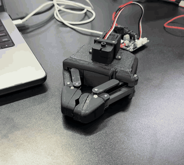
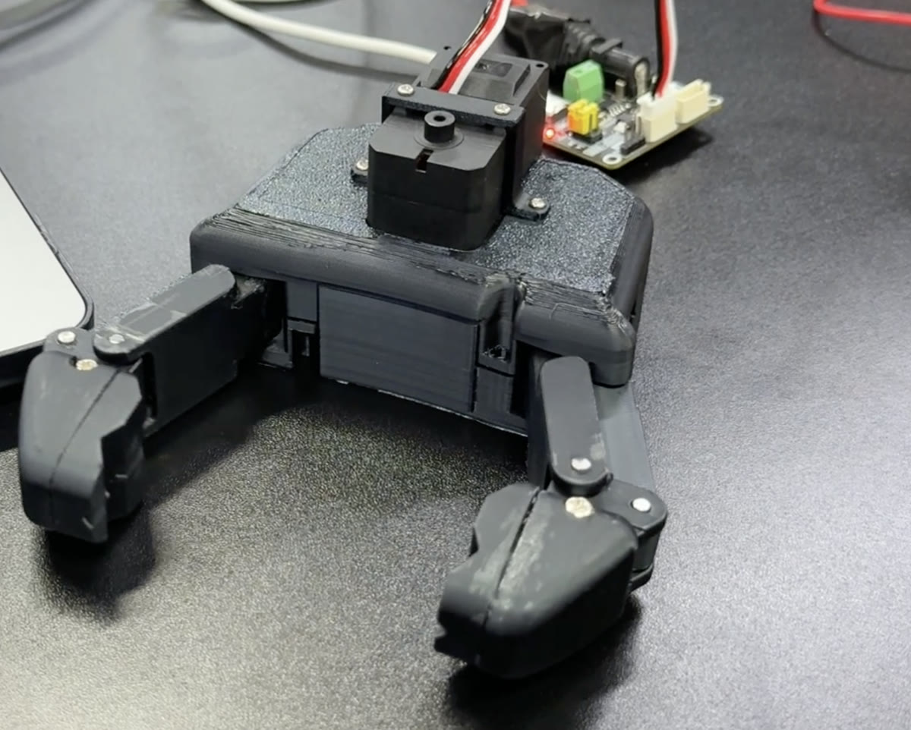

# Pinc'Open (MOBILAB-UDESC)

Fork of [Pollen Robotics' Pinc'Open](https://github.com/pollen-robotics/PincOpen), a low-cost, open-source parallel gripper driven by a Feetech STS3215 servo. **For the design, BOM, CAD files and assembly guide, see the [original README](https://github.com/pollen-robotics/PincOpen#readme).**

This fork adds:
- a setup for the Feetech motor test notebook, and
- a bridge that lets Unitree Dex1 software (e.g. `xr_teleoperate --ee dex1`) drive the gripper.

<a href="docs/pincopen_open_close.mp4"></a>

## Hardware



Connect the motor through a Feetech/Waveshare bus servo adapter and **power the adapter** (USB alone doesn't power the servo). Find the serial port:
```bash
ls /dev/cu.usbmodem*           # macOS
ls /dev/ttyACM* /dev/ttyUSB*   # Linux
```
Only one program can use the port at a time: stop other notebooks' kernels or servers first.

## Configure and test the motor

```bash
uv venv --python 3.11 .venv
uv pip install --python .venv/bin/python \
  "pypot @ git+https://github.com/pollen-robotics/pypot.git@support-feetech-sts3215" \
  jupyterlab ipykernel
.venv/bin/jupyter lab notebooks/feetech_test.ipynb
```
In [`feetech_test.ipynb`](notebooks/feetech_test.ipynb), set `PORT` and `ID`, then check the positions by hand: open ≈ -140°, closed ≈ 0°. Only then run the flash cell, which writes the angle limits and torque protection to the motor.

## Use it as a Unitree Dex1 gripper

[`dex1_bridge/`](dex1_bridge/) exposes the gripper on the same DDS topics as Unitree's [Dex1_1 service](https://github.com/unitreerobotics/dex1_1_service): `rt/dex1/<right|left>/cmd` and `/state`, with `q = 0` closed and `q = 5.4` rad open.

```bash
uv venv --python 3.10 .venv-dex1   # cyclonedds 0.10.2 has no macOS arm64 wheels after 3.10
uv pip install --python .venv-dex1/bin/python pyserial ipykernel matplotlib \
  "unitree_sdk2py @ git+https://github.com/unitreerobotics/unitree_sdk2_python.git"
.venv-dex1/bin/python -m ipykernel install --prefix .venv --name pincopen-dex1 --display-name "PincOpen Dex1 (py3.10)"

source .venv-dex1/bin/activate && cd dex1_bridge
python pincopen_dex1_server.py --calibrate --port <port> --motor-id <id>   # once per gripper
python pincopen_dex1_server.py --port <port> --side right [-n eth0]
```

Test it with [`dex1_bridge_tests.ipynb`](notebooks/dex1_bridge_tests.ipynb) (kernel "PincOpen Dex1 (py3.10)", set `PORT`, run top to bottom, server stopped), or with the server running:
```bash
python test_dex1_sweep.py --watch   # state only
python test_dex1_sweep.py           # Unitree's sine sweep
```
Details in [dex1_bridge/README.md](dex1_bridge/README.md).

## Layout

| Path | Content |
|---|---|
| `cad/`, `docs/` | CAD files and assembly docs from the original project, plus this fork's photo and video |
| `notebooks/feetech_test.ipynb` | Configure and test the motor |
| `notebooks/dex1_bridge_tests.ipynb` | Test the Dex1 bridge |
| `dex1_bridge/` | Dex1 DDS server, Feetech driver, calibration, test client |

## License

Based on [Pinc'Open](https://github.com/pollen-robotics/PincOpen) by Pollen Robotics, licensed under [CC BY-SA 4.0](http://creativecommons.org/licenses/by-sa/4.0/). This fork is distributed under the same license.
