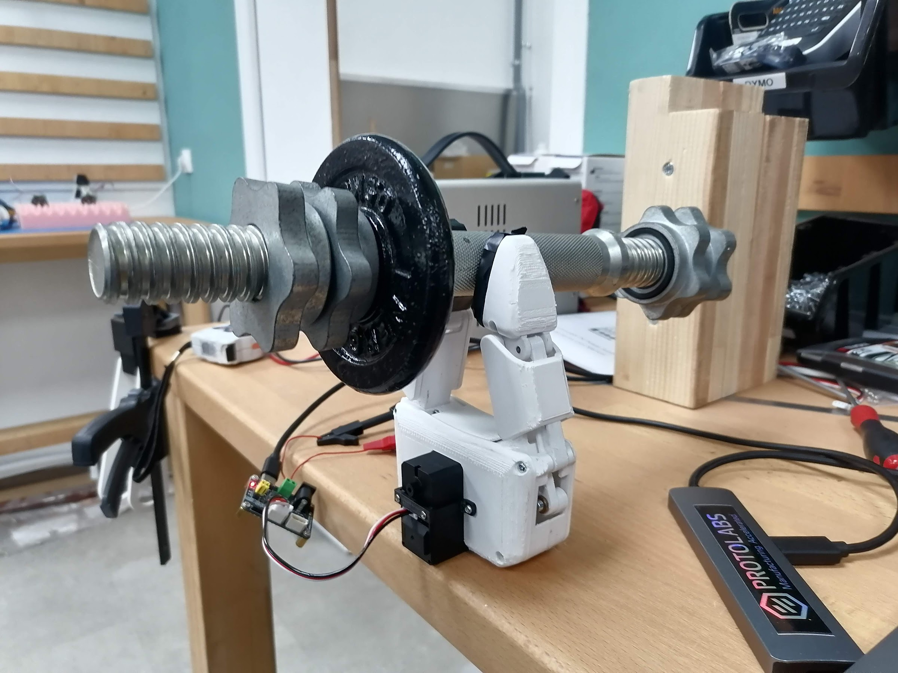
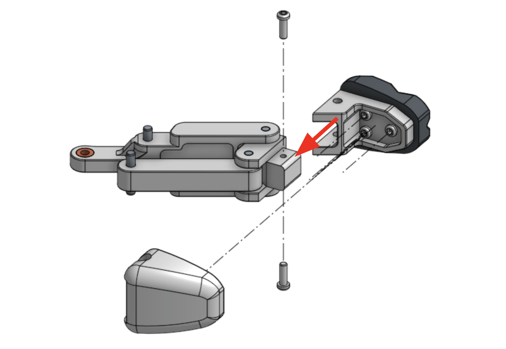
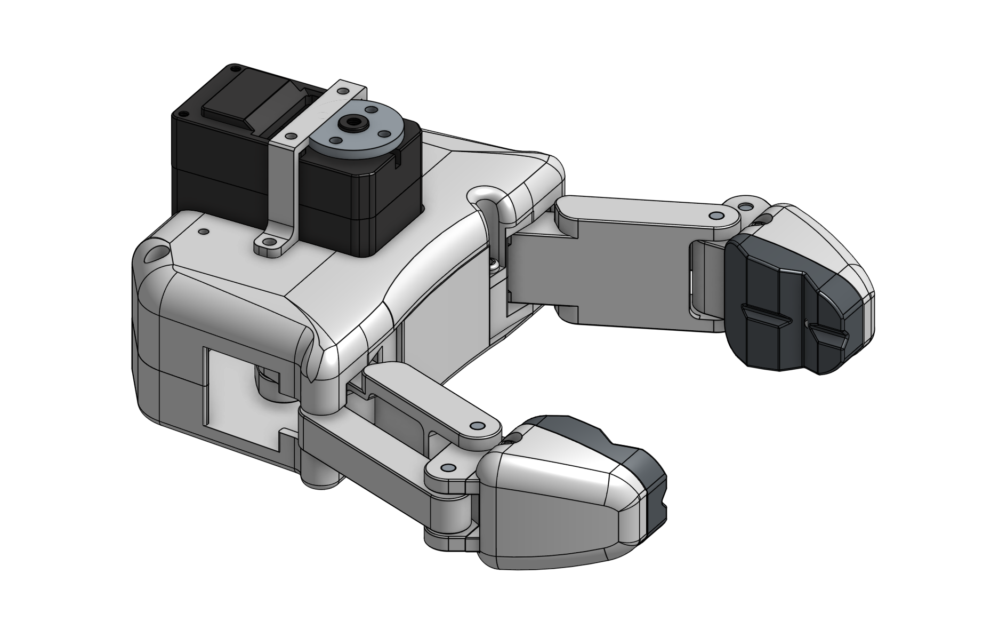
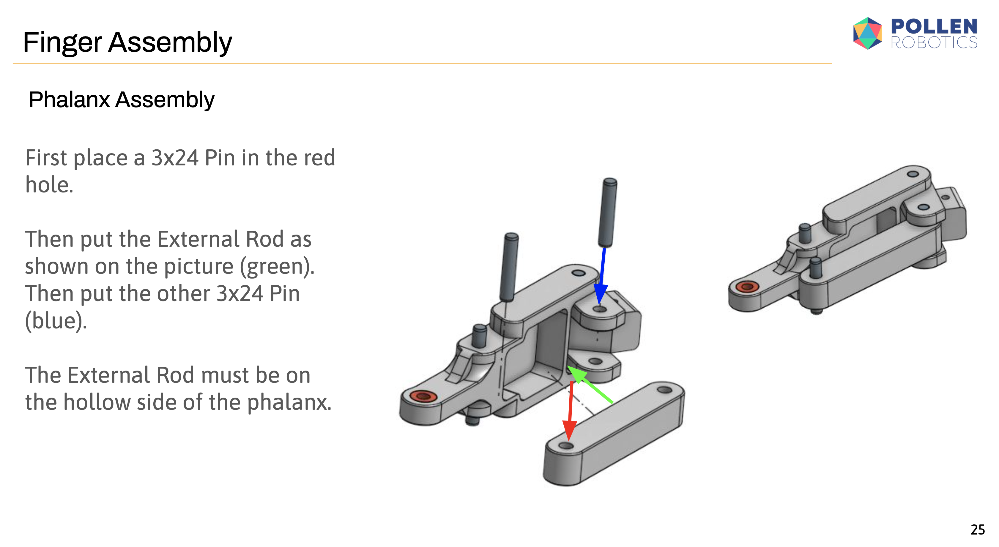

[![CC BY-SA 4.0][cc-by-sa-shield]][cc-by-sa]

This work is licensed under a
[Creative Commons Attribution-ShareAlike 4.0 International License][cc-by-sa].

[![CC BY-SA 4.0][cc-by-sa-image]][cc-by-sa]

[cc-by-sa]: http://creativecommons.org/licenses/by-sa/4.0/
[cc-by-sa-image]: https://licensebuttons.net/l/by-sa/4.0/88x31.png
[cc-by-sa-shield]: https://img.shields.io/badge/License-CC%20BY--SA%204.0-lightgrey.svg

[](https://www.youtube.com/shorts/5o2Au9_xjNQ)

# Pinc'Open project
[Pinc'Open](https://github.com/pollen-robotics/PincOpen/tree/main) is a low-cost (~25€) and open-source parallel-finger gripper, derived from [Pollen Robotics Reachy 2](https://www.pollen-robotics.com/reachy/)'s gripper

## Table of contents

- [Pinc'Open Presentation](#pincopen-project)
    - [What is Pinc'Open](#what-is-pincopen)
    - [Reachy 2 "Pincette" gripper](#reachy-2-pincette-gripper)
    - [Areas of focus](#areas-of-focus)
- [Build Resources](#build-resources)
    - [BOM (Bill Of Materials)](#bom-bill-of-materials)
    - [STL Files and Onshape document](#stl-files-and-onshape-document)
    - [Configure the motor before assembly](#configure-the-motor-before-assembly)
    - [Assembly Guide](#assembly-guide)
    - [How to flash and test the gripper](#how-to-flash-and-test-the-gripper)
    - [Use it as a Unitree Dex1 gripper](#use-it-as-a-unitree-dex1-gripper)
    - [Repository layout](#repository-layout)
- [Project Updates & Community](#project-updates--community)
    - [Updates history](#updates-history)
    - [Project posts](#project-posts)
    - [To Do List](#to-do-list)
    - [FAQ](#faq)
    - [Contact](#contact)
    - [Thank you](#thank-you)

## What is Pinc'Open?
The aim of this project is to make robotic manipulation more accessible, so that anyone with an idea but not the budget can make advances in this field possible.  
The quality of movement, mechanical strength and precision may not be as good as an industrial product, but a 2-finger parallel robotic gripper can be built for less than 25€! And we'll see that the performance is still good.  


The secondary goal is to make this gripper compatible with the [SO-ARM100](https://github.com/TheRobotStudio/SO-ARM100) open-source arm, so that the same motor as the current gripper can be used on our Pinc'Open. So the 25€ includes a motor that is already included in the $100 of the SO-ARM100.

What's more, the tip is interchangeable! That way, you can fit exactly what you need for your particular application.  


## Reachy 2 "Pincette" gripper
The Pincette v1.0 gripper, released at the same time as [Reachy 2](https://www.pollen-robotics.com/reachy/), is a two-parallel-finger hand designed for versatility and accurate, strong grasping.  

Joints are based on high-quality standard components, and mechanical parts are machined from metal for greater rigidity and precision.  
However, these qualities come at a considerable cost: today, for just a few units manufactured, the BOM costs ~€1,700 per unit.  

This is acceptable depending on the application, but not for those who want to build a low-cost robotic gripper.

## Areas of focus:
- Make every mechanical custom part 3D printable, and not easily breakable, to avoid expensive metal machining.
- Change the expensive [Robotis Dynamixel motor](https://emanual.robotis.com/docs/en/dxl/x/xm430-w210/) to a cheap [Feetech STS3215](https://www.feetechrc.com/525603.html) motor.
- Remove all the high-quality but expensive standard components and find mechanical tricks to replace them.
- Find a trick to imitate a torque limitation while using position control on a motor that doesn't have this feature. Otherwise, the motor burns (or turns off thanks to security) or the plastic mechanical part can break...


# Build Resources
## BOM (Bill Of Materials)
The list of all needed components is available here:  
[PincOpen BOM](https://docs.google.com/spreadsheets/d/1iEKxfsqo3RnKw0QtdLJ2hEtYNDy2LInxrnCFLAhpxHk/edit?usp=sharing)  

There is the standalone PincOpen gripper BOM (~25€), then optional components like the interface with the [SO-ARM100](https://github.com/TheRobotStudio/SO-ARM100) project, or a Realsense camera stand for example.

## STL Files and Onshape document
STL and Steps files can be found [here](https://github.com/pollen-robotics/PincOpen/tree/main/cad)  

Everyone can access the Onshape document too:   
[Link Onshape](https://cad.onshape.com/documents/96518c699fd03eea508b06d3/w/d5f95a6266b027d84ae48634/e/e41e675b82a4f671f01336e0)  
  

Note that you can set a configuration in the assembly, like the default assembly, or with the interface part for SO-ARM100, or the configuration for camera mounting.

## Configure the motor before assembly
To configure the motor as it should be, please first clone & install [Lerobot library](https://github.com/huggingface/lerobot/tree/main).

Then connect and power up your motor, and run the following command: 

```bash
python lerobot/scripts/configure_motor.py --port /dev/ttyACM0 --brand feetech --model sts3215 --baudrate 1000000 --ID <ID>
```

Make sure to replace the port with your USB serial port and the ID with "6".

## Assembly Guide
Here is an assembly guide to explain how to print all the needed custom parts and how to use them to build this gripper.  
[=> Assembly Guide](/docs/PincOpen_Assembly_Instructions.pdf)  
  

There is also a guide about how to build an Intel Realsense D405 camera mount here:  
[=> Camera Mount Assembly](/docs/camera_mount_assemby.md)

## How to flash and test the gripper
The gripper is tested and configured from the [Feetech test notebook](notebooks/feetech_test.ipynb), which uses the [pypot library with Feetech support](https://github.com/pollen-robotics/pypot/tree/support-feetech-sts3215).

**1. Install** (from the repository root, with [uv](https://docs.astral.sh/uv/)):
```bash
uv venv --python 3.11 .venv
uv pip install --python .venv/bin/python \
  "pypot @ git+https://github.com/pollen-robotics/pypot.git@support-feetech-sts3215" \
  jupyterlab ipykernel
```

**2. Connect** the motor through a Feetech/Waveshare bus servo adapter, and power the adapter (the servo needs its own supply, USB alone is not enough). Find the serial port:
```bash
ls /dev/cu.usbmodem*      # macOS
ls /dev/ttyACM* /dev/ttyUSB*   # Linux
```

**3. Run the notebook:**
```bash
.venv/bin/jupyter lab notebooks/feetech_test.ipynb
```
In the first cells, set `PORT` to your serial port and `ID` to your motor's ID. Then:
- Check the positions by hand (torque off): open should read about **-140°**, closed about **0°**. If the values are far off, re-mount the motor horn before going further.
- Only then run the "flash" cell. It writes the angle limits and torque protection to the motor's EEPROM.
- Try `open()` and `close()`.

Only one program can use the serial port at a time: shut down the notebook's kernel before running anything else on the gripper.

## Use it as a Unitree Dex1 gripper
[`dex1_bridge/`](dex1_bridge/) makes the Pinc'Open speak the same DDS interface as Unitree's [Dex1_1 gripper service](https://github.com/unitreerobotics/dex1_1_service), so software written for the Dex1 (for example [xr_teleoperate](https://github.com/unitreerobotics/xr_teleoperate) with `--ee dex1`) drives it without changes.

| | Topic | Message |
|---|---|---|
| command | `rt/dex1/<right\|left>/cmd` | `unitree_go MotorCmds_` (`cmds[0].q`) |
| state | `rt/dex1/<right\|left>/state` | `unitree_go MotorStates_` (`q`, `dq`, `tau_est`) |

Positions use the Dex1 convention: `q = 0` is closed, `q = 5.4` rad is fully open.

**1. Install** a separate Python 3.10 environment (`cyclonedds==0.10.2`, required by the Unitree SDK, has no macOS arm64 wheels for newer Pythons):
```bash
uv venv --python 3.10 .venv-dex1
uv pip install --python .venv-dex1/bin/python pyserial ipykernel matplotlib \
  "unitree_sdk2py @ git+https://github.com/unitreerobotics/unitree_sdk2_python.git"
.venv-dex1/bin/python -m ipykernel install --prefix .venv --name pincopen-dex1 --display-name "PincOpen Dex1 (py3.10)"
source .venv-dex1/bin/activate
cd dex1_bridge
```

**2. Calibrate** once per gripper: torque turns off, you close and then open the gripper by hand. This writes `calibration.json`:
```bash
python pincopen_dex1_server.py --calibrate --port <serial port> --motor-id <ID>
```

**3. Run the server:**
```bash
python pincopen_dex1_server.py --port <serial port> --side right             # on your computer
python pincopen_dex1_server.py --port <serial port> --side right -n eth0     # on the robot network
```

**4. Test it**, either:
- with the [Dex1 bridge test notebook](notebooks/dex1_bridge_tests.ipynb) (kernel "PincOpen Dex1 (py3.10)", set `PORT` in its setup cell), which runs the bridge itself and checks the motor, the calibration and the whole DDS interface. Stop the server first, since it holds the serial port, and run the cells from top to bottom; or
- with the server running, from a second terminal:
  ```bash
  python test_dex1_sweep.py --watch    # print the state only
  python test_dex1_sweep.py --q 2.7    # move half open and hold
  python test_dex1_sweep.py            # Unitree's sine sweep
  ```

See [dex1_bridge/README.md](dex1_bridge/README.md) for the details: units, command timeout, and the limits of the emulation.

## Repository layout
| Path | Content |
|---|---|
| `cad/` | STL and STEP files |
| `docs/` | Assembly instructions, camera mount, grip tips, changelog |
| `notebooks/feetech_test.ipynb` | Configure and test the motor (pypot) |
| `notebooks/dex1_bridge_tests.ipynb` | Test the Unitree Dex1 bridge |
| `dex1_bridge/` | Unitree Dex1 DDS bridge: server, Feetech driver, calibration, test client |


# Project Updates & Community
## Updates history
[Updates history](/docs/changelog.md)  

## Community projects
- ROS2 PincOpen Driver - School of Engineering and Computing, Christopher Newport University - [[Github](https://github.com/CNURobotics/pinc_open_driver)]. 
- MuJoCo Simulation Support (PR) - [[Github](https://github.com/pollen-robotics/PincOpen/pull/6)] 
- ICRA 2026 Smart grasping using embedded 3D force (tactile) sensing from Melexis - Milan Amighi, Constantin Scholz and Bram Vanderborght (Brubotics - VUB & imec), in collaboration with Melexis - [[Tutorial Website](https://mech.vub.ac.be/multibody/ICRA_conference_workshop.htm)]
- [Mobile Manipulation with LeKiwi and PincOpen](https://huggingface.co/blog/zuoxingdong/mobile-manipulation-lekiwi-pincopen) - Xingdong Zuo - [[Github](https://github.com/zuoxingdong/lerobot-lekiwi)]

## To Do List
- Video showing the advantages of this more complex mechanism
- Technical explanation about how it was designed
- New camera mounting supports

## Project posts
- [Fingertips for better grip](/docs/grip_tip.md)
- [Mobile Manipulation with LeKiwi and PincOpen](https://huggingface.co/blog/zuoxingdong/mobile-manipulation-lekiwi-pincopen) - Xingdong Zuo - [[Github](https://github.com/zuoxingdong/lerobot-lekiwi)]

## FAQ
WIP

## Contact
[Contact me or Pollen Robotics](/docs/contact.md)

## Thank you
Huge thanks to those who have contributed to this project so far:
- [Antoine Pirrone](https://github.com/apirrone) for making great demos, all the advice and feedback
- [Pierre Rouanet](https://github.com/pierre-rouanet) for Feetech motors integration in pypot  
- [Jeremy Laville](https://www.linkedin.com/in/jeremy-laville-1038b176/) & [Matthieu Lapeyre](https://www.linkedin.com/in/matthieulapeyre/) for mechanical advice and original Reachy 2 Pincette co-development

