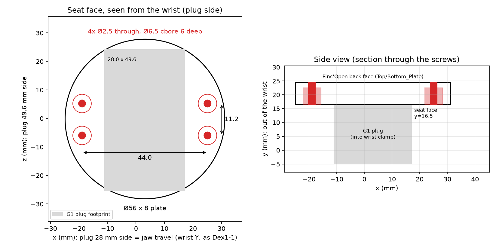

# Pinc'Open on the Unitree G1 wrist

This page covers mounting Pinc'Open on a **G1 EDU / Flagship** wrist in place of the stock Dex1-1 gripper. The [Dex1 bridge](../dex1_bridge/README.md) then makes Unitree software drive it as a Dex1-1.

Unitree publishes no drawing or CAD of the wrist socket. This page collects what is published, what was measured, and what still has to be checked on the robot.



## Parts

| File | What it is |
|---|---|
| [`cad/stl/Interface_G1.stl`](../cad/stl/Interface_G1.stl) | Printable adapter: G1 plug + Pinc'Open plate, one solid, 56 × 29.5 × 56 mm |
| [`cad/step/Interface_G1_Plate.step`](../cad/step/Interface_G1_Plate.step) | Editable STEP of the Pinc'Open plate only (same coordinates as the STL) |
| [`cad/g1/build_interface_g1.py`](../cad/g1/build_interface_g1.py) | Script that builds both files from the dimensions below |
| [`cad/g1/vendor/`](../cad/g1/vendor/) | The G1 plug it starts from (lerobot, Apache-2.0, see `NOTICE.md`) |

The adapter replaces `Interface_ARM100` (the SO-100 mount). The other Pinc'Open parts don't change.

### Why the plug is reused instead of remodelled

The only geometry known to fit a real G1 clamp is the printed plug from lerobot's [G1 hardware modifications](https://huggingface.co/datasets/lerobot/unitree-g1-hardware-modifications). Its README says it matches [Wuji's G1 docking adapter](https://github.com/wuji-technology/wuji-description/tree/main/hand/attachment/unitree-g1-attachment) to 0.00001 mm.

The plug exists only as a mesh, so the script keeps it unchanged and models only the plate (in CadQuery). That way the clamp fit is proven, and the part we designed is still an editable STEP.

## Dimensions

### Pinc'Open side (measured from `cad/step/Interface_ARM100.step`)

- **4 holes, 44.0 × 11.2 mm rectangle**, centred on the back face of `Top_Plate` / `Bottom_Plate` (2 holes in each). The holes in the plates are Ø2.5 pilots.
- **Screws**: 4× thermoplastic (self-tapping) **2.5 × 8 mm**, the same as the rest of the BOM. Their heads sit in Ø6.5 counterbores on the arm side; 2 mm of plate stays under each head.
- The jaws travel along the 44 mm axis.

### G1 plug (lerobot `unitree-g1-openarm-adapter.stl`, in mm)

- The body that enters the wrist is 28.0 × 49.6 mm in footprint and 21.5 mm deep, from y = −5 to y = 16.5 in the drawing. It has two rails on the bottom face.
- The plug seats against the wrist at **y = 16.5**. The Pinc'Open plate starts there: Ø56 × 8 mm, the same outline as the lerobot plate, so it clears the wrist the same way.
- The OpenArm plate's 4× Ø3.2 holes on a 27 × 27 mm square are not used.

### G1 wrist (EDU / Flagship)

From Unitree's assembly guides ([Dex3-1](https://www.unitree.com/images/G1-Flagship%20Version%20A&B%20Terminal%20Three-Fingered%20Dexterous%20Hand%20Dex3-1%20Disassembly%20and%20Assembly%20Guide%20Manual%20V1.1.pdf), [Inspire hand](https://www.unitree.com/images/G1-Flagship%20Version%20C%20End%20Dexterous%20Hand%20Disassembly%20and%20Assembly%20Guide%20Manual.pdf)):

- The hand's plug sits in the wrist socket. A **clamp hoop is tightened with 2× M3** screws (reportedly M3×10).
- A **cover held by 2× M2** screws (reportedly M2×5) protects the hand's power connector.
- The hand cable runs along the arm in clips (M4) to a signal connector on the robot's back.
- There is no bolt circle and no ISO flange.
- The Basic/Standard G1 reportedly uses 6× M3 screws instead (from a [third-party catalogue](https://atlas.birdwave.io/port-types/unitree-g1-wrist-clamp), not verified). This adapter is only for the clamp-plug wrist.

From the official URDF ([unitree_ros `g1_description`](https://github.com/unitreerobotics/unitree_ros/tree/master/robots/g1_description), `g1_29dof_mode_15_with_dex1_1.urdf`):

- **Hand frame**: `left/right_base_joint` sits 41.5 mm along x from `*_wrist_yaw_link`.
- **Dex1-1 masses**: the base is 0.191 kg and each finger is 0.087 kg. The **jaws travel along wrist ±Y**.
- **Orientation, inferred**: the wrist-yaw mesh is about 36 mm wide along Y and 60 mm along Z. The plug STL's centre is offset 3.1 mm along x, which matches the wrist face's 3.2 mm Y offset. Together these put the plug's **28 mm side along wrist Y**.
- **Result**: the adapter orients the Pinc'Open jaws along the plug's 28 mm side, the same way as the Dex1-1. This orientation also leaves all 4 screw heads outside the plug, where you can reach them.

Other figures:

- **Wrist motors** (`motor_info.md`): pitch and yaw are 13.4 N·m peak; roll is 41 N·m.
- **Arm payload**: about 2 kg (about 3 kg on the EDU), per [support.unitree.com](https://support.unitree.com/home/en/G1_developer).
- **Mass**: the Dex1-1 weighs 550 g. Pinc'Open plus this adapter (about 50 g in PETG at 100% infill) is lighter.

## Print

- **Material**: PETG or ASA, 0.4 mm nozzle.
- **Infill**: **100%**. The plug carries the whole gripper through the clamp.
- **Orientation**: put the flat gripper-side face of the plate on the bed, with the plug pointing up. Every hole and counterbore is then vertical and opens upward, and the plug's clamp faces are walls, so the part needs no support.
- **Fit**: test the plug in the wrist before mounting the gripper. If it's tight, sand the rails lightly rather than scaling the model.

## Assemble

1. Screw the adapter onto the back of the gripper with 4× 2.5 × 8 thermoplastic screws, inserted from the plug side into the Top/Bottom_Plate pilot holes. The pattern is symmetric, so the servo can face either way; pick the side that routes its cable best on each arm.
2. Remove the stock hand: loosen the clamp (2× M3) and the connector cover (2× M2).
3. Insert the plug with the jaws travelling along the wrist's Y axis, the way the Dex1-1 sat. Tighten the clamp, then refit the cover over the (unused) hand connector.

## Wire

The wrist hand connector's pinout and voltage are not published, so **leave it unused**. Run a separate cable along the arm instead, as lerobot did, held in the existing cable clips or with Velcro ties.

- **Power**: the G1 side panel has XT30 outputs of 58 V/5 A, 24 V/5 A and **12 V/5 A**.
  - Standard (7.4 V) STS3215: take the 12 V XT30 through a buck converter set to 7.4 V (3 A or more).
  - 12 V STS3215: connect the 12 V output directly.
  - Check the label on your servo before powering it.
- **Bus**: put the Feetech/Waveshare bus servo adapter near the shoulder or in a backpack, and connect it by USB to **PC2** (the Jetson). It shows up as `/dev/ttyACM*` or `/dev/ttyUSB*`.
- **Routing**: move the wrist through its full pitch, yaw and roll range before tightening the ties, so nothing pulls or snags.

## Run

On PC2, using the same bridge as on a desk:

```bash
python pincopen_dex1_server.py --calibrate --port /dev/ttyACM0      # once per gripper
python pincopen_dex1_server.py --port /dev/ttyACM0 --side right -n <dds-iface>
```

- If Unitree's `dex1_1_service` is installed, stop it first so that only one process publishes on `rt/dex1/<side>/*`.
- `xr_teleoperate --ee dex1` then drives Pinc'Open as a Dex1-1.
- Run one bridge per arm, each with its own serial port and `--side`.

## Rebuild or change the adapter

```bash
uv venv --python 3.11 .venv-cad
uv pip install --python .venv-cad/bin/python cadquery trimesh manifold3d networkx scipy shapely matplotlib
.venv-cad/bin/python cad/g1/build_interface_g1.py --drawing
```

The dimensions are constants at the top of the script.

- `--jaw-axis plug_long` turns the jaws 90°. In that orientation the screw heads land inside the plug footprint, so the script stops with an error.
- If you need that orientation, add Ø6.5 access bores through the plug and use longer screws. First check, on the mesh, that the bores miss the rails and the clamp contact faces.

## Still to confirm on the robot

- [ ] Remove a Dex1-1 and check that its jaws travel parallel to its plug's **short (28 mm)** side. The orientation above comes from the mesh, not from a photo.
- [ ] Which plug face sits under the clamp cover, and whether the plate clears the cover.
- [ ] Clamp fit and play with the printed plug, with the clamp screws torqued.
- [ ] Cable routing through the full wrist range.
